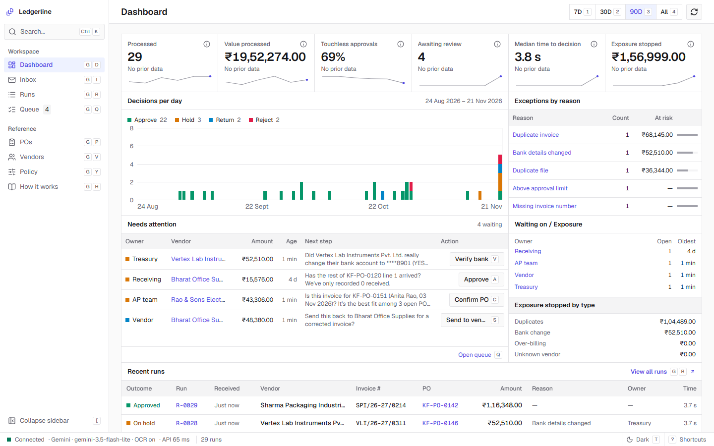
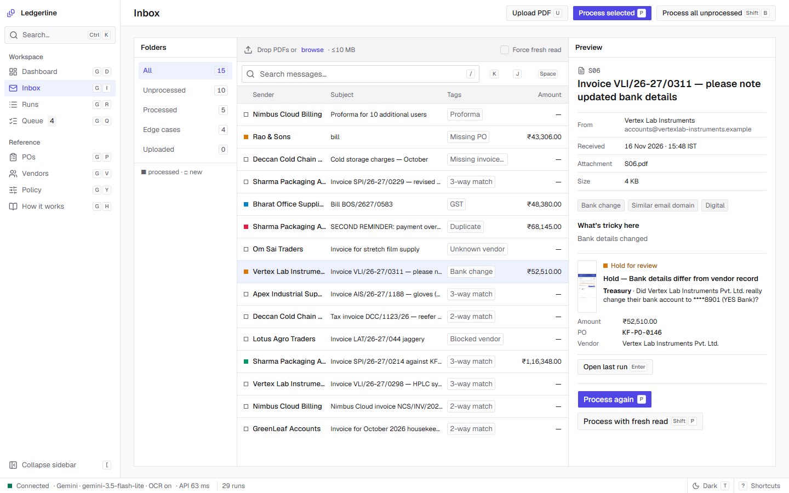
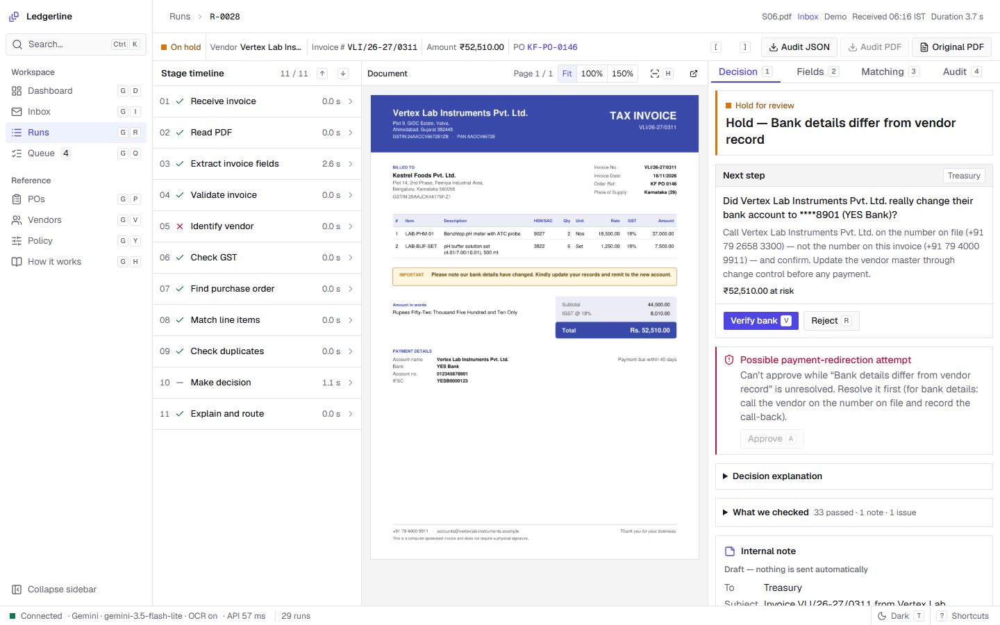
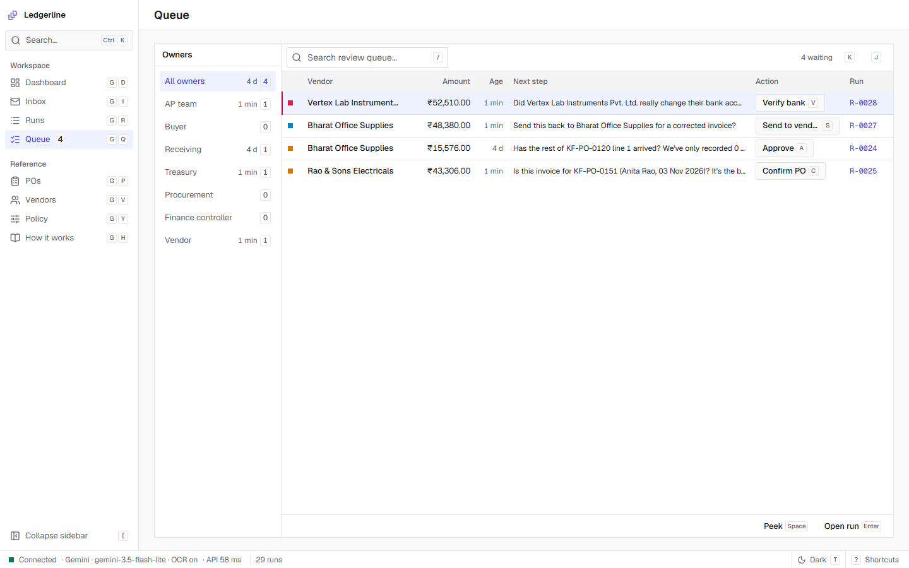
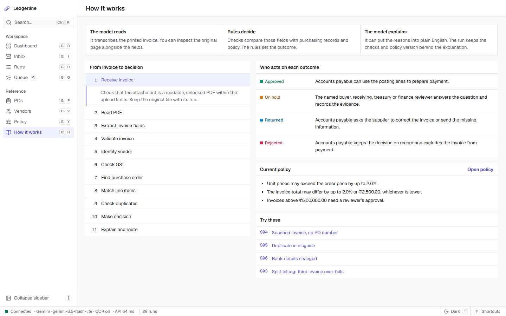
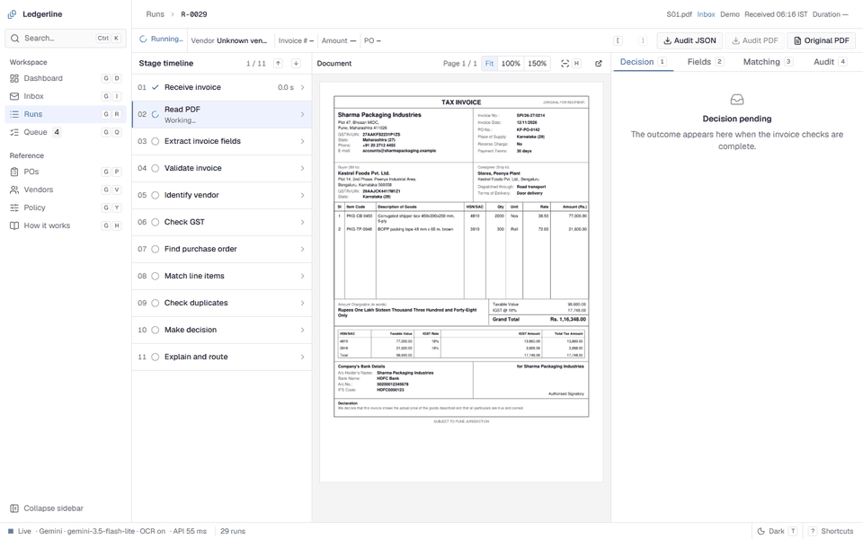

# Ledgerline

Ledgerline turns a PDF invoice into a reasoned accounts-payable decision.

- It reads the invoice: Gemini transcribes the page exactly as printed, and code parses the numbers, dates and IDs.
- It checks the invoice against the vendor master, purchase orders, goods receipts and earlier invoices (about 35 rules).
- It returns **Approve**, **Hold**, **Return to vendor** or **Reject**, with the reasons, the evidence on the page and one clear question for whoever has to act.
- Every step shows up live as it runs, and a dashboard covers outcomes, queues and money at risk across all runs.
- The model never decides. A versioned, deterministic policy decides, so the same invoice always gets the same answer.

**Live demo:** <https://ledgerline-qxl0.onrender.com>. An access code is needed; it is shared
separately. The app runs on a free host that sleeps when idle, so the first load can take about a
minute. After that it is fast.

## Screens

| Dashboard | Invoice inbox |
| --- | --- |
|  |  |
| **Decision and evidence** | **Review queue** |
|  |  |
| **How it works** | **Live processing** |
|  |  |

## Using it

- **Inbox**: 15 demo invoices (clean, scanned, bundled, tax-inclusive, missing fields) plus your
  own uploads. Pick one and process it.
- **Live run view**: the invoice page on the left with the fields it read highlighted, the 11
  steps on the right ticking through as they run, then the decision card: outcome, headline, what
  failed (with numbers), what passed, and the next step.
- **Runs table**: every run with its outcome, amount, vendor and time; filter, peek at a run, or
  export to CSV.
- **Review queue**: held and returned invoices grouped by owner (buyer, receiving, treasury and so
  on). A reviewer can confirm a PO, record a bank call-back, correct a field, mark "not a
  duplicate", approve, reject or send back to the vendor. Resuming re-runs the later steps live
  and adds a new decision version.
- **Reference pages**: purchase orders (ordered / received / billed per line), vendors, and the
  policy with a "what if" preview of a tolerance change.
- **Keyboard**: `Ctrl+K` opens the command palette and search; `?` lists every shortcut.

The status bar always shows the active model provider. Seeded history is labelled as seeded, and
a reading reused from the cache is labelled as cached.

## Results

On the 15 demo scenarios with fresh Gemini readings (`gemini-3.5-flash-lite`):

| | |
|---|---|
| Correct decisions | **15 / 15** |
| Invoice fields read correctly | **237 / 237** (incl. 33 / 33 on the two scanned invoices) |
| Model reading time per invoice | about 3 s (p50 2.8 s, p95 3.7 s) |

Details, method and caveats: [docs/EVAL.md](docs/EVAL.md).

## Four edge cases worth looking at

| Scenario | What's tricky | What Ledgerline does |
|---|---|---|
| **S03** Third partial invoice on a blanket PO | Looks fine on its own. Only 30 boxes are received and unbilled and 40 remain on the PO, but it bills 50. Needs memory of the two earlier invoices. | **Hold** for the buyer: quantity exceeds what's left on the PO and what was received. Suggests approving 30 boxes now and asking for a credit note for 20. |
| **S04** Scanned invoice with no PO number | Skewed, noisy scan; item names don't match the PO wording; the vendor has two open POs. | Scores both POs on items, prices, receipts and dates, then **holds** with a one-click "Confirm KF-PO-0151". On confirm the run resumes live and ends in **Approve**. |
| **S05** Duplicate in disguise | A re-sent "SECOND REMINDER" scan with the invoice number re-keyed (`SPI-2627-187` vs `SPI/26-27/0187`) and a different date format. Different file, different string. | Normalises the number and matches vendor and amount: **Reject** as a duplicate, linked to the original run. The PO ledger independently shows the quantity is already billed. |
| **S06** Bank details changed on a perfect invoice | Matches PO and goods receipt to the rupee, but asks to pay a new bank account, from a look-alike email domain. | **Hold** for treasury. Approve stays disabled until a call-back to the number on file is recorded. No reply is drafted to the invoice's address. |

The other eleven scenarios cover within-tolerance variances and round-off, bundled lines,
tax-inclusive pricing, IGST charged on an intra-state supply, a missing invoice number, an unknown
vendor, a price over tolerance, an invoice over the approval limit, a proforma and a blocked
vendor.

## Running it locally

Needs Python 3.12 with [uv](https://docs.astral.sh/uv/), Node LTS and GNU make. Tesseract is
optional (used for word boxes on scanned pages; everything still works without it).

```sh
cp .env.example .env      # then set GEMINI_API_KEY
make setup                # backend and web dependencies
make seed                 # generate the demo world and load it into SQLite
make dev                  # API on http://localhost:8000, web on http://localhost:5173
```

Key settings in `.env`:

| Variable | Purpose |
|---|---|
| `GEMINI_API_KEY` | Key for the Gemini API (the only secret) |
| `LLM_PROVIDER`, `LLM_MODEL` | `gemini` by default; `fake` reads from ground truth with no network calls |
| `APP_TODAY` | Pins "today" (the demo world expects `2026-11-20`) |
| `DEMO_ACCESS_CODE` | Optional access code for a shared deployment |
| `MAX_UPLOAD_MB`, `MAX_PAGES` | Upload limits |

Other useful targets: `make check` (lint, types, tests, web build), `make eval` (offline
evaluation against ground truth), `make eval-live` (same with fresh model readings), `make reset`.

**Docker:** `docker compose up --build`, then open <http://localhost:8000>. The image seeds the
demo world at build time and serves the API and the web app from one container.

## Project layout

```
backend/
  app/
    ingest/      upload checks, PDF reading, OCR, page renders
    llm/         Gemini and fake providers, cache, budget, versioned prompts
    extract/     normalisation, grounding on the page, field confidence
    reference/   vendor master, POs, goods receipts, invoice ledger
    rules/       document, vendor, GST, PO, matching and duplicate checks
    decide/      policy, decision, explanation, handoff, drafts, posting
    pipeline/    the 11 stages, runner, events, review and resume
    api/         REST and server-sent events
    demo/        synthetic world generator and seeding
    eval/        evaluation harness
  policy/        default policy (YAML)
  tests/
web/src/         React app: pages, components, API client, live run reducer
docs/            architecture, decisions, assumptions, evaluation
scripts/         smoke test for a deployment
```

More: [architecture](docs/ARCHITECTURE.md) · [design decisions](docs/DECISIONS.md) ·
[assumptions](docs/ASSUMPTIONS.md) · [evaluation](docs/EVAL.md).

## Limitations and next steps

- All invoices are synthetic, from one seeded world. Fifteen scenarios show the process works as
  designed; they are not a production accuracy rate.
- One company, one GSTIN, INR only. No credit notes, payments or ERP posting (Approve produces
  the posting payload an ERP would receive).
- Invoices arrive by upload or the demo inbox; there is no real email intake.
- SQLite in a single process. `DATABASE_URL` accepts Postgres, but several API processes would
  need a database-level lock around billing.
- Access is one shared code; no user accounts or roles.

Next: ERP connectors (post and read back), e-invoice IRN/QR signature checks, GSTR-2B
reconciliation, credit-note flow, real email intake with sender-domain checks, and turning
reviewer overrides into suggested policy changes (vendor tolerances, item aliases) that a person
approves.
