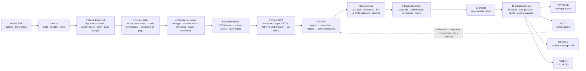
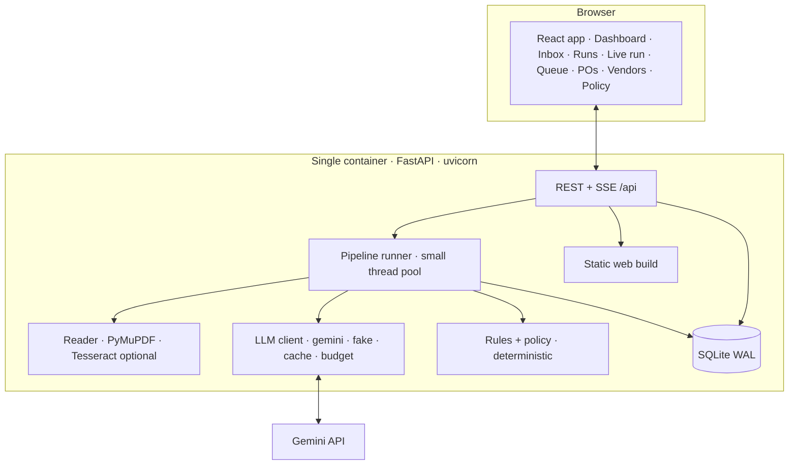

# Architecture

## The idea in one line

**The model reads, rules decide, the model explains.**

- **Read (model).** One multimodal call to Gemini returns every invoice field as the literal
  string printed on the page ("1,16,348/-", "03-Oct-2026", "KF PO 0146"). No arithmetic, no
  guessing.
- **Parse and ground (code).** Strings become `Decimal` amounts, dates (day-month first) and
  canonical IDs. Each value is found on the page (text layer, or OCR words on scans) to get a
  highlight box. Confidence per field comes from two things: was it found on the page, and did a
  validator pass (GSTIN checksum, arithmetic, amount in words).
- **Decide (code).** About 35 rules each produce a `CheckResult` (pass / warn / fail, severity,
  owner, suggested outcome, evidence numbers). A precedence function turns them into one outcome.
  The policy is a versioned YAML file, and every run records the version it used.
- **Explain (template, optional model polish).** Each reason has a template for the headline,
  the one question for the owner, the suggested action and any drafts. The model may reword the
  summary; a guard checks every number from the template is still there, otherwise the template
  text is kept.

## Process map

## Stages

| # | Stage | Input → output | Decision points |
|---|---|---|---|
| 1 | `intake` | file → stored document, sha256, pages | over limits / encrypted / damaged → refused with a clear message |
| 2 | `read_document` | PDF → per-page kind, words with boxes, OCR words, PNG renders | scanned vs digital; OCR available? |
| 3 | `extract_fields` | PDF → raw strings → typed, grounded fields with confidence | document type; legibility |
| 4 | `validate_document` | extraction → checks D00–D08 | not a tax invoice → stop early |
| 5 | `identify_vendor` | GSTIN / name → vendor; bank and sender compared → V01–V05 | unknown / blocked / bank changed |
| 6 | `check_tax` | GSTINs, tax lines → T01–T04 | intra- vs inter-state |
| 7 | `resolve_po` | PO reference or candidates → PO → P01–P05 | explicit / inferred / ambiguous / none |
| 8 | `match_lines` | invoice lines ↔ PO lines ↔ goods receipts + ledger → M01–M06 | 2- vs 3-way; tolerance; over-billing |
| 9 | `check_duplicates` | invoice ledger → X01–X03 | same file / same invoice / fuzzy |
| 10 | `decide` | all checks + policy → decision (+ A01, A02) | REJECT > critical HOLD > RETURN > HOLD > APPROVE |
| 11 | `explain_route` | decision → explanation, handoff, drafts, posting | template first; model polish optional |

A failed check never stops the pipeline: the reviewer gets the full picture. Only an unreadable
file or a document that isn't an invoice stops early; the remaining stages are marked skipped
with a reason.

**Outcomes.** Approve: pay per terms, posting payload ready. Hold: an internal person must act
(AP clerk, buyer, receiving, treasury, procurement or controller). Return: the document is
defective and the vendor must re-issue it. Reject: must not be paid (duplicate, blocked vendor,
not an invoice).

**Human in the loop.** Held and returned runs wait in the review queue. A reviewer either
finishes the run (approve, reject, send to vendor) or resumes it with an override (confirm PO,
record a bank call-back, correct a field, mark not a duplicate). Resuming re-runs the later stages
live and appends a new decision version. Every action needs a name and a note and is kept in the
audit log.

## System

- **Backend:** Python 3.12, FastAPI, Pydantic v2, SQLAlchemy 2, PyMuPDF. All model calls go
  through `backend/app/llm/`; prompts are versioned Markdown files.
- **Frontend:** React, Vite, TypeScript, Tailwind, shadcn/ui, TanStack Query, Recharts. API
  types are generated from the backend's OpenAPI schema.
- **Page images** are rendered on the server as PNG; highlight boxes are absolutely positioned
  with coordinates normalised to 0–1.
- **One container** serves the API and the built web app at one URL.

## Data model

Reference data (the "procurement spreadsheet"): `company`, `vendors`, `purchase_orders`,
`po_lines`, `goods_receipts`.

Work data:

| Table | Holds |
|---|---|
| `documents` | each PDF once, keyed by sha256 |
| `runs` | one row per processing run: extraction, checks, stage states, matching, current decision and decision history, policy version, overrides, summary columns for lists |
| `run_events` | the ordered event log of a run (`run_id`, `seq`) |
| `review_actions` | who did what, when, with which note |
| `invoice_ledger` | every decided invoice: vendor, normalised number, date, total, PO, file hash, final outcome and the PO quantities it billed |
| `llm_cache` | saved model readings keyed by file hash, provider, model and prompt version |

The invoice ledger is what makes split billing and duplicate detection work: an invoice counts
against a PO's billed balance only once it is finally approved.

## Event stream

Every run writes events to `run_events` as it goes: `run.created`, `run.started`, then per stage
`stage.started` → `stage.log`* → `stage.completed` (status, summary, checks, stage detail),
then `decision.made` and a terminal `run.completed`, `run.awaiting_review` or `run.failed`.
Review adds `review.recorded` and `run.resumed`.

`GET /api/runs/{id}/events?after=<seq>` is a server-sent event stream that tails that table
every 250 ms, with a heartbeat every 15 s. A client that joins late, or reconnects, replays from
the last sequence number it saw. There is no in-memory pub/sub to lose.

Every model call is logged as a `stage.log` event with provider, model, prompt id and version,
latency, token counts, attempts and whether the reading came from the cache. The live run view
shows these under "Details".
